# Tech SOP：活動由零到完結設定指南

> 依據 **main** 現行程式碼整理（2026-11）。截圖取自 demo：`demo.brandactivation.hk`（demo site 2025 / 付費示範活動）。舊有 `FEATURES_LIST.md`、`FORM_CONFIG_DOCUMENTATION.md` 等可能過時，以此份為設定準則。

**適用對象**：Tech / 後台操作員  
**系統**：Event Check-in & Management System（Express + MongoDB + EJS）  
**截圖目錄**：`docs/sop-screenshots/`

---

## 目錄

1. [總覽流程](#1-總覽流程)
2. [前置：環境與權限](#2-前置環境與權限)
3. [主線 A：建立 Event](#3-主線-a建立-event)
4. [主線 B：設定報名表 FormConfig（含何處改 title／欄位）](#4-主線-b設定報名表-formconfig含何處改-title欄位)
5. [主線 C：Email Template](#5-主線-cemail-template)
6. [主線 D：自動發送郵件條件](#6-主線-d自動發送郵件條件)
7. [主線 E：前台 Register / Payment](#7-主線-e前台-register--payment)
8. [主線 F：活動 Check-in 與 Report](#8-主線-f活動-check-in-與-report)
9. [支線：LuckyDraw](#9-支線luckydraw)
10. [支線：Badge Design](#10-支線badge-design)
11. [支線：排桌 Seating](#11-支線排桌-seating)
12. [驗收 Checklist](#12-驗收-checklist)
13. [路徑速查](#13-路徑速查)

---

## 1. 總覽流程

```
建立 Event
    ↓
設定 FormConfig（報名欄位／標題／Thank You／Yes-No／Slug）
    ↓
（付費活動）設定 Payment Tickets + 票券 UI
    ↓
建立 Email Templates（welcome / reminder / payment_receipt…）
    ↓
設定自動寄信條件（emailSettings + Yes/No 對應模板）
    ↓
提供前台 Register／Payment 連結給客戶測試
    ↓
活動當日 Check-in（RSVP／掃描／分站）
    ↓
下載 Report／匯出資料
```

可並行的支線（不阻擋主線上線）：

- LuckyDraw（獎品 → 設定 → Panel／開獎畫面）
- Badge Design（設計 → 儲存 → iPad／列印）
- 排桌 Seating（分類 → 排位 → 匯出）

---

## 2. 前置：環境與權限

### 2.1 必要環境變數

| 變數 | 用途 |
|------|------|
| `MONGODB_URI` | 資料庫 |
| `DOMAIN` | 公開網域（含 `https://`）。報名連結、付款回調、郵件追蹤皆依賴 |
| `PORT` | 預設 `3377` |

### 2.2 郵件（至少一種）

- **SES API（預設）**：`SENDER_EMAIL` + AWS 憑證  
- **SMTP（活動可勾選）**：`SMTP_HOST` / `SMTP_PORT` / `SMTP_USER` / `SMTP_PASS` + `SENDER_EMAIL_SMTP`

### 2.3 付款（付費活動）

| 變數 | 說明 |
|------|------|
| `PAYMENT_GATEWAY` | `stripe` 或 `wonder`（預設 wonder） |
| Stripe | `STRIPE_SECRET_KEY`, `STRIPE_PK`, `STRIPE_WEBHOOK_SECRET` |
| Wonder | `WONDER_APP_ID`, `WONDER_PRIVATE_KEY`, `WONDER_CUSTOMER_UUID` |

Webhook：

- Stripe：`POST {DOMAIN}/web/webhook/stripe`
- Wonder：`{DOMAIN}/web/webhook/wonder`

### 2.4 角色與權限

| 角色 | 說明 |
|------|------|
| `admin` | 全站無限制 |
| `staff` / `reception` | 依 `allowedEvents` + `eventPermissions.functions` |
| `user` | 前台用戶 |

Staff 常用功能鍵：

| 工作 | 最少需要的 keys |
|------|----------------|
| RSVP／簽到／自動電郵設定 | `rsvp`（+ `scan` / `stationCheckin` / `report` / `import`） |
| 報名頁設定 | `formConfig`（預覽加 `website`） |
| 郵件模板 | `emailTemplate`（紀錄加 `emailRecords`） |
| 付費／交易 | `transactions`（見下方注意） |
| 抽獎 | `prizes` + 對應 `luckydraw*` |
| 徽章 | `badges` |
| 排桌 | `seating` |

> **注意**：側欄「付費設定」用 `transactions` 顯示，但路由 `/events/:eventId/payment-settings` 實際權限檢查走 `rsvp`。Staff 建議兩個都開。

權限設定：`/auth/users/:id/edit`（admin）

---

## 3. 主線 A：建立 Event

### 入口畫面

活動列表：`/events/list`

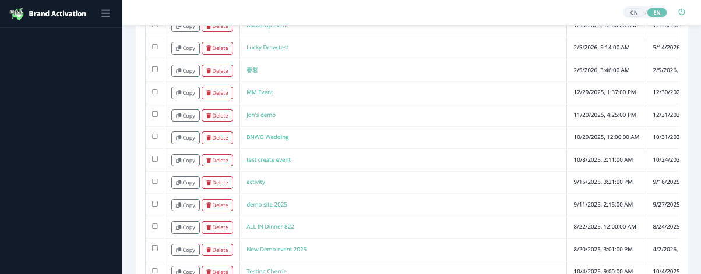

### 步驟

1. 登入後台 → `/events/list`
2. 點 **Create Event** → `/events/create`
3. 填寫：
   - **Event Name** `name`（後台顯示名稱；報名頁 H1 可另外在 FormConfig 覆蓋）
   - **Event Start Time** `from`
   - **Event End Time** `to`（必須晚於開始）
4. 提交後進入該活動 RSVP 頁：`/events/:eventId`

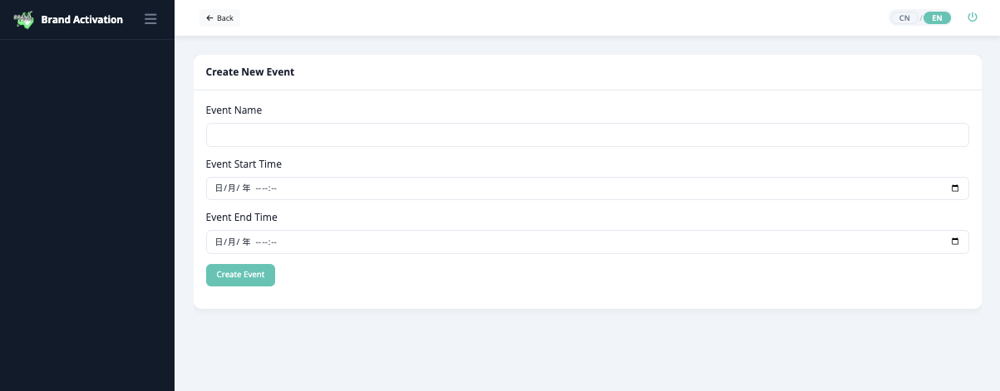

### 補充

| 操作 | 路徑／位置 |
|------|-----------|
| 改活動名稱（Event.name） | RSVP 頁標題旁 **Edit Event Name**，或 `/events/:eventId/edit-name` |
| 複製活動 | 列表列上 **Copy** → `POST /events/:eventId/copy`（複製設定／FormConfig／票券；**不**複製 users、中獎、交易） |
| 刪除 | 僅 admin；列表 **Delete** 或批量刪除 |

非 admin 建立者會自動獲得該活動 `allowedEvents` 與功能權限。

---

## 4. 主線 B：設定報名表 FormConfig（含何處改 title／欄位）

### 4.0 入口（兩個入口同一個頁）

| 入口 | 路徑 |
|------|------|
| 側欄 **Website → Reg Page Config** | `/formConfig/:eventId` |
| 權限 | `formConfig` |

頁頂有：**Export JSON**／**Import JSON**／**Reset to Default**／**Save Config**。  
**每次改完必須按 Save Config**，否則不會寫入 DB。

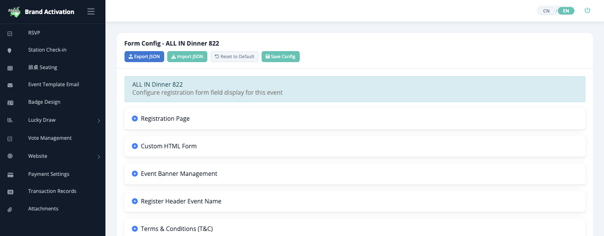

---

### 4.1 「報名表 title」到底改邊度？— 三種 title 分清

很多人講「改 reg form title」其實有三種不同東西：

| 你想改咩 | 去邊度改 | 出現喺邊 |
|----------|----------|----------|
| **後台活動名稱**（列表、RSVP 標題） | RSVP → **Edit Event Name** | 後台；報名頁 *browser tab* 後備標題 |
| **報名頁 H1 大標題**（訪客見到嘅活動名） | FormConfig → 展開 **Register Header Event Name** → `Event name (ZH/EN)` | 前台 `/web/:id/register` 頂部 H1 |
| **表單分區標題**（例如「聯絡人資料」） | FormConfig 頁面下方 → 每個 Section 的 `Section title (ZH/EN)` | 前台表單每個 section 標題 |

#### A) 報名頁 H1／副標（最常要改）

展開卡片 **Register Header Event Name**：

| 欄位 | 作用 |
|------|------|
| `Event name (ZH)` / `(EN)` | 報名頁 H1。**兩邊都留空 = 唔顯示 H1**（browser tab 仍用 `event.name`） |
| `Sub header (ZH)` / `(EN)` | H1 下面嘅副標；可 HTML；留空則隱藏 |
| `Subtitle / hint (ZH)` / `(EN)` | 灰色提示字（預設「請填寫以下資料…」） |

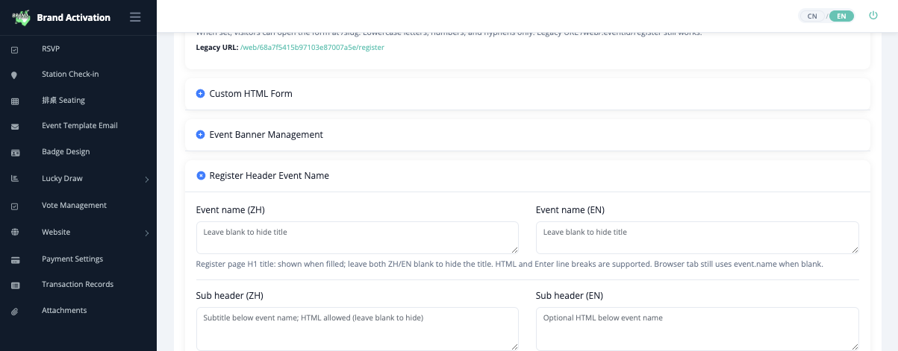

> **Tip**：客戶要「報名頁顯示中英不同活動名、但後台列表保持短名」→ 只改呢度，唔好改 Event.name。

#### B) 報名開關、關閉頁、公開 Slug

展開卡片 **Registration Page**：

| 欄位 | 作用 |
|------|------|
| **Enable Registration Page** | ON = 顯示表單；OFF = 顯示關閉頁 |
| **Title when closed** | 關閉頁標題；可勾 *Allow blank* 唔顯示預設字 |
| **Message when closed** | 關閉頁說明（支援較長文案） |
| **Registration Page Slug** | 小寫＋數字＋連字號 → 公開短網址 `{DOMAIN}/{slug}` |

頁面會顯示 **Legacy URL**：`/web/{eventId}/register`（永遠可用）。

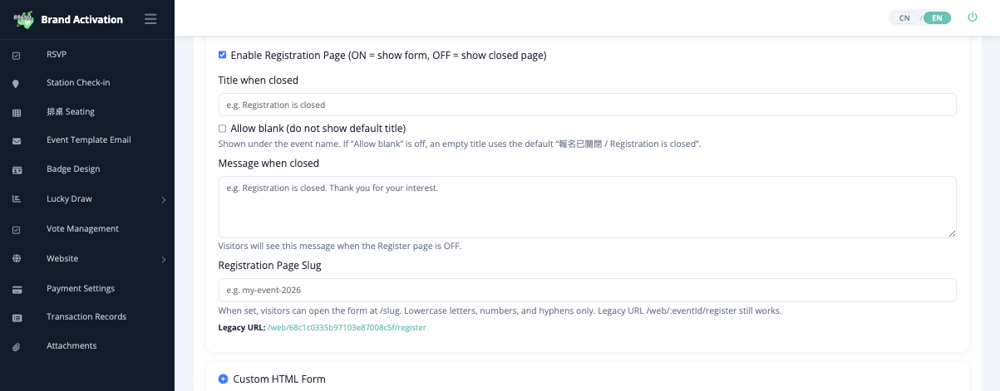

---

### 4.2 其餘可摺疊卡片一覽（由上到下）

FormConfig 全部設定都喺**同一頁**，用摺疊卡片分開。記住：**改完要 Save Config**。

| 卡片名稱 | 改咩內容 | 影響邊度 |
|----------|----------|----------|
| **Registration Page** | 開關、關閉文案、slug | 公開報名 URL／關閉頁 |
| **Custom HTML Form** | 獨立自訂 HTML 報名頁（進階） | `/web/:id/custom-form`（與標準 FormConfig 表單分開） |
| **Event Banner Management** | 上傳／刪除 banner（JPG/PNG ≤5MB） | 報名頁頂部橫額 |
| **Register Header Event Name** | H1、副標、灰色提示 | 報名頁標題區 |
| **Terms & Conditions (T&C)** | 啟用條款、標題、連結字、彈窗 HTML | 提交前必須同意 |
| **Agreement** | 多組 Title + checkbox 同意項 | 報名表額外同意區塊 |
| **Thank You (success page)** | 成功頁文案 + Yes/No 題與對應電郵模板 | `/register/success` 與寄信政策 |
| **Exclusive Application Completed Page** | Application 補填完成頁文案 | `/web/:id/application/...` 完成後 |
| **Payment Tickets (Register Page Text & Category Buttons)** | 票券區 UI 文案、分類按鈕 | 僅 UI；**真票券價錢在 Payment Settings** |
| **Language Settings** | 預設語言、是否顯示中英切換 | 報名頁語言 |

頁面**下方**（摺疊區之後）才是真正嘅 **Sections + Fields** 編輯器 + **Form Preview**。

---

### 4.3 改報名表「內容」＝改 Sections / Fields

位置：FormConfig 頁面向下捲到 **Form Preview** 之上。

#### Section（分區）

- 每個 section 有 `Section title (ZH)` / `(EN)` → 前台顯示成「聯絡人資料」這類標題  
- **+ Add Section** 新增分區  
- 可調整順序

#### Field（欄位）

每個欄位可設：

| 設定 | 說明 |
|------|------|
| **Field Name** | 內部 key（寫入 `users[].formData`／頂層相容欄位），例如 `email`、`name`、`remarks` |
| **Label ZH/EN** | 訪客見到嘅欄位名稱 |
| **Placeholder ZH/EN** | 輸入框提示 |
| **Type** | `text` / `email` / `tel` / `select` / `textarea` / `checkbox` / `radio` / `display` |
| **Required** | 必填 |
| **Display** | 勾選 = 前台顯示；唔勾 = 後台仍可見但前台隱藏 |
| **Order** | 顯示順序 |
| **Max length** | `0` = 不限 |
| `select` 選項 | 可加「其他」自填 |
| `email` | 可開「確認電郵」第二欄 |
| **條件顯示 `showWhen`** | 依其他欄位值或 Thank You Yes/No 顯示 |

按鈕：**+ Add Field**、**+ Add Section**；垃圾桶刪欄位。

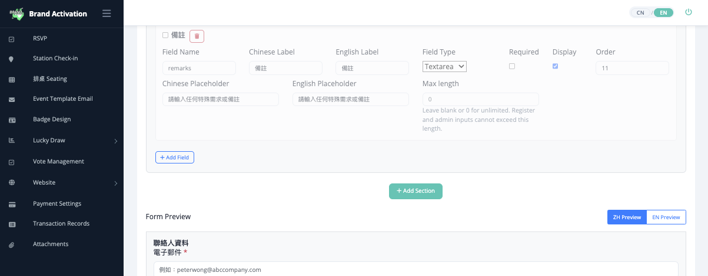

#### 快速對照：想改 X 去邊

| 想改 | 位置 |
|------|------|
| 「聯絡人資料」四個字 | 該 Section 的 Section title |
| 「電子郵件」label | 該 Field 的 Label ZH/EN |
| placeholder「例如：王小明」 | 該 Field 的 Placeholder |
| 加多一個「公司」欄 | **+ Add Field**，Type=`text`，name=`company` |
| 隱藏某欄但後台仍要 | 取消勾 **Display** |
| 必填 | 勾 **Required** |

---

### 4.4 Thank You／成功頁 + Yes/No

展開 **Thank You (success page)**：

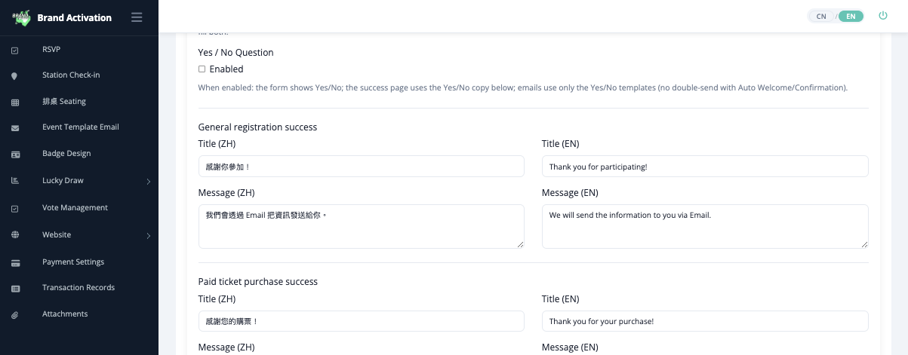

#### 一般成功文案（Yes/No 關閉時用）

| 區塊 | 欄位 |
|------|------|
| General registration success | `Title/Message` ZH+EN → 免費報名成功頁 |
| Paid ticket purchase success | `Title/Message` ZH+EN → 付費成功頁 |

#### Yes / No Question（重要）

勾 **Enabled** 後：

- 報名表出現 Yes/No 題（可改 Title、Yes/No label 雙語）  
- 可指定 **Email Template when answer is Yes/No**  
- 可分別覆寫 On Yes／On No 的免費／付費成功頁文案  

> **寄信影響（互斥）**：一旦啟用 Yes/No 且有對應模板，報名後 **只寄 Yes/No 模板**，唔會再跟「Auto Send Welcome」開關雙重寄（見第 6 節）。頁面上亦有英文提示說明此互斥。

---

### 4.5 付費活動：票券本體 vs 報名頁票券 UI

**真票券（價錢、售賣期、promo）** 唔喺 FormConfig，喺：

側欄 **Payment Settings** → `/events/:eventId/payment-settings`

| 項目 | 說明 |
|------|------|
| **Payment Event** 開關 | `isPaymentEvent` |
| 每張票 | Category key、中英名稱、Price、開始／結束時間 |
| Promo Codes | 固定金額折扣；折後 $0 可繞過付款閘道 |
| Promo code display | 是否喺公開報名頁顯示折扣碼輸入 |

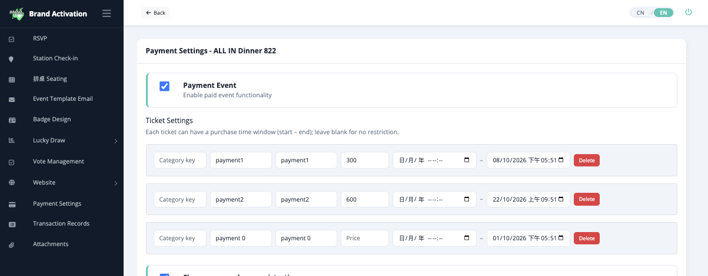

FormConfig 嘅 **Payment Tickets (Register Page Text & Category Buttons)** 只控制報名頁票券區 **文案／分類按鈕 UI**。`categoryButtons[].key` 必須對應票券的 `category`。

---

### 4.6 語言

展開 **Language Settings**：

- 預設語言 `zh` / `en`  
- 是否顯示前台中英切換掣  

---

### 4.7 建議驗收

- [ ] 報名頁 H1／副標正確（Register Header）  
- [ ] Section／Field label、必填、雙語正確  
- [ ] Slug 或 `/web/:eventId/register` 可開啟  
- [ ] 關閉報名時顯示關閉頁文案  
- [ ] （付費）票券分類與價錢正確、過期票不可選  
- [ ] Save Config 後再開前台硬刷新確認  

---

## 5. 主線 C：Email Template

### 入口

側欄 **Event Template Email** → `/events/:eventId/emailTemplate`（權限：`emailTemplate`）

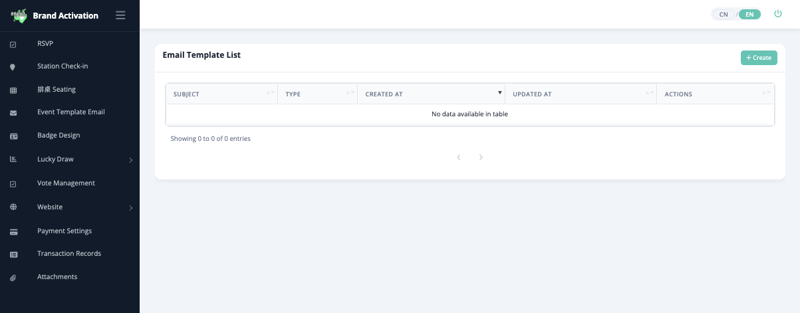

### 模板類型

| type | 用途 |
|------|------|
| `invitation` | 邀請 |
| `welcome` | 歡迎／報名確認（自動 welcome／confirmation 都搵呢類） |
| `knowledge` | 知識／資訊 |
| `reminder` | 提醒（需手動或批量寄） |
| `payment_receipt` | 付款憑證（付費成功會嘗試自動寄） |
| `invoice` | 發票（需 `INVOICE_EMAIL_ENABLED=true`） |

### 建立步驟

1. 列表點 **Create** → `/events/:eventId/emailTemplate/create`  
2. 填 **Email Subject**  
3. 選 **Email Type**（可按 **Load template for this type** 載入該類型樣板）  
4. 用 TinyMCE 編輯 HTML；可用 **Get variable reference** 查變數  
5. **Save Email**

常用變數：`{{user.name}}`, `{{user.email}}`, `{{event.name}}`, `{{qrcodeUrl}}`, `{{checkinLink}}` 等。

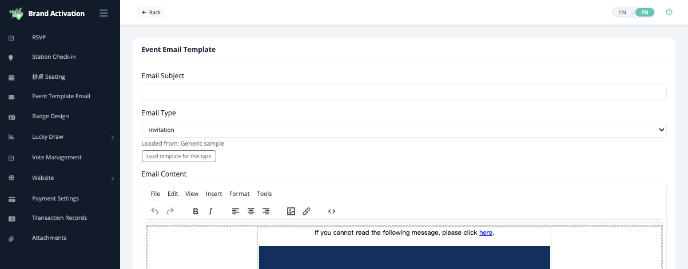

### 其他操作

| 操作 | 位置 |
|------|------|
| Seed 預設模板 | `/events/:eventId/emailTemplate/seed?type=welcome` |
| 預覽 | 後台預覽或 `/emailTemplate/preview/:id` |
| 單人重寄 | RSVP 列表 → **Resend...** |
| 批量寄 | RSVP 勾選 → Batch Send Email → 選模板 |
| 郵件紀錄 | RSVP 頁 **Email Records** → `/events/:eventId/email-records` |

---

## 6. 主線 D：自動發送郵件條件

### 入口

RSVP 頁 `/events/:eventId` → 工具列 **Auto Email Setting**  
API：`PATCH /events/:eventId/emailSettings`

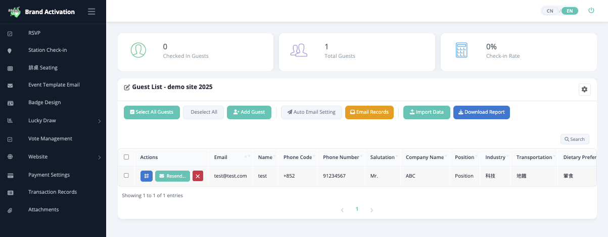

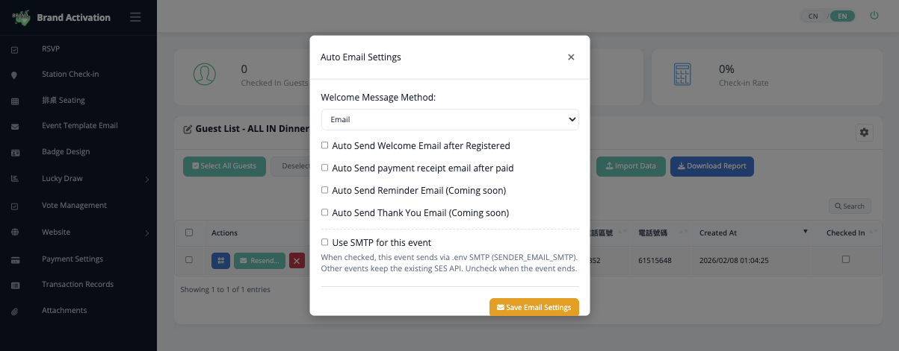

### 可設定項

| 欄位 | 作用 |
|------|------|
| Welcome Message Method | `email` / `sms` / `both` |
| Auto Send Welcome Email after Registered | `sendWelcomeEmail` — **有效** |
| Auto Send payment receipt email after paid | 付費成功相關 |
| Auto Send Reminder / Thank You | UI 可存，**目前無排程自動觸發**（用手動／批量） |
| Use SMTP for this event | `useSmtp` — 勾選後此活動改走 `.env` SMTP（其他活動仍用 SES） |

### 寄信政策（互斥）

```
若 FormConfig Yes/No 已啟用
    → 只寄 yesEmailTemplateId / noEmailTemplateId（有答案且有設模板）
    → 不走 welcome / confirmation 開關
否則
    → 免費報名／$0 票／Application 完成／後台加人：sendWelcomeEmail → welcome 模板
    → 付費 webhook 入 RSVP：sendConfirmationEmail → 仍使用 type=welcome 模板
```

付費成功時另會嘗試寄 `payment_receipt`（與上述開關獨立）。

### 觸發時機一覽

| 時機 | 行為 |
|------|------|
| 公開免費報名 `POST /web/:id/register` | policy `welcome` |
| Application 補填完成 | policy `welcome` |
| $0／promo 免付費入 RSVP | policy `welcome`（+ 可能 invoice） |
| Stripe／Wonder 付款成功 webhook | policy `confirmation` + `payment_receipt` |
| 後台 RSVP 新增用戶 | 依 welcome 設定 |

### Tech 注意

- Confirmation 自動信找的是 **`welcome` 類型模板**，不是獨立 confirmation type。  
- 公開 `register` **不可**直接帶 `ticketId`；付費必須走 checkout。  
- 郵件追蹤（開信 pixel／連結改寫）預設開；可用 `EMAIL_LINK_TRACKING_ENABLED=false` 只關連結改寫。

---

## 7. 主線 E：前台 Register / Payment

### 7.1 給客戶的連結

| 類型 | URL |
|------|-----|
| 標準 | `{DOMAIN}/web/{eventId}/register` |
| Slug | `{DOMAIN}/{registerSlug}` |
| 網站殼 | `{DOMAIN}/web/{eventId}` |
| Application（已匯入用戶補填） | `{DOMAIN}/web/{eventId}/application/{userId}?token=...` |

側欄亦可：**Website → Registration Page** 開前台預覽。

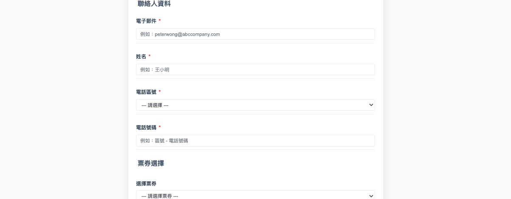

### 7.2 免費流程

1. 用戶填表 → 提交  
2. 寫入 `Event.users`  
3. 依第 6 節寄信  
4. 導向 `/web/:eventId/register/success`

### 7.3 付費流程

1. 用戶選票券（+ 可選 promo）  
2. `POST /web/:eventId/stripe-checkout`（名稱歷史遺留；實際跟 `PAYMENT_GATEWAY`）  
3. 跳轉 Stripe／Wonder  
4. Webhook 確認付款 → 建立／更新 Transaction → 寫入 RSVP user  
5. 寄 confirmation（welcome 模板）+ payment_receipt  
6. Success 頁顯示購票文案  

失敗：`/web/:eventId/register/fail`

### 7.4 建議測試清單

- [ ] 免費報名成功、資料出現在 RSVP  
- [ ] 自動信／Yes-No 信有收到（檢查 Spam、Email Records）  
- [ ] （付費）Sandbox 付款成功 → RSVP 有人、Transaction paid  
- [ ] Webhook 必須指向正確 `DOMAIN`（本地需 tunnel）  
- [ ] Success／Fail 頁文案正確  

---

## 8. 主線 F：活動 Check-in 與 Report

### 8.1 進場簽到（主場）

| 方式 | 路徑／操作 |
|------|-----------|
| RSVP 列表手動 | `/events/:eventId` → 用戶列 **Checked In** checkbox（寫入 `isCheckIn` + `checkInAt`） |
| 批量全部簽到 | 同頁相關批量操作 |
| QR 掃描 | `/events/:eventId/scan`（權限 `scan`） |

RSVP 頁同時顯示 Checked In / Total / Check-in Rate，並可 **Download Report**、**Download QR Code**、**Import Data**。

### 8.2 分站簽到

側欄 **Station Check-in** → `/events/:eventId/station-checkin`（`stationCheckin`）

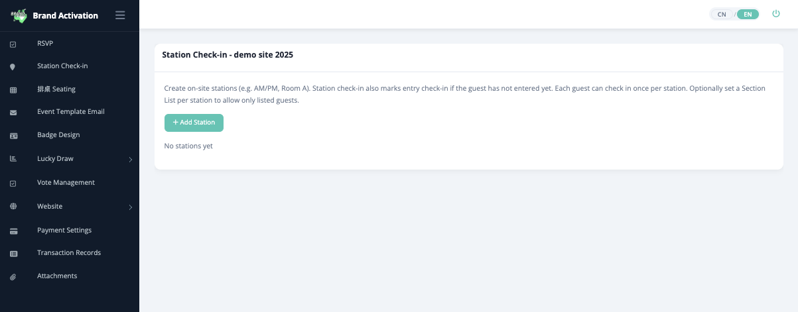

- **+ Add Station** 建立分站（例：AM/PM、Room A）  
- 可選為分站設 Section List，只准名單內來賓簽到  
- 若用戶尚未主場簽到，分站簽到時會 **一併** 標記主場 `isCheckIn`  
- 每位來賓每個分站只能簽一次  

### 8.3 報告

| 報告 | 路徑 |
|------|------|
| 單活動下載 | RSVP → **Download Report** → `/events/:eventId/report`（可勾選欄位） |
| 多活動批量 | `/events/list` → **Batch Download Report** |
| 交易 | `/events/:eventId/transactions` |
| 郵件紀錄 | `/events/:eventId/email-records` |

### 8.4 活動結束建議

- [ ] 匯出 RSVP／簽到報告存檔  
- [ ] 匯出交易（付費活動）  
- [ ] （如有）匯出抽獎名單、排桌 ZIP  
- [ ] 關閉報名頁（FormConfig → Registration Page → 取消 Enable）

---

## 9. 支線：LuckyDraw

### 設定順序

1. **獎品** 側欄 Lucky Draw → **Prize Management** → `/prizes/:eventId/prizes/list`  
   - **+ Add Prize**／Batch Upload／Download Template  
2. **頁面設定** → `/events/:eventId/luckydraw_setting`  
   - 上傳背景圖（**.jpg only**）  
   - Award List 頁密碼（可留空）  
3. **遊戲視覺設定** `/events/:eventId/luckydraw-config/edit`  
4. **資格**：候選人 = **已主場簽到**（`isCheckIn === true`）且尚未中獎  
5. **控制 Panel** `/events/:eventId/luckydraw/panel` — 選獎、抽獎數、Socket 同步  
6. **開獎大屏** `/games/app/luckydraw_1/?id={eventId}`  
7. **後台名單** `/events/:eventId/luckydraw/list` — 可匯出、設定顯示欄位  
8. **公開中獎頁** `/events/:eventId/luckydraw/award` — 可設密碼  

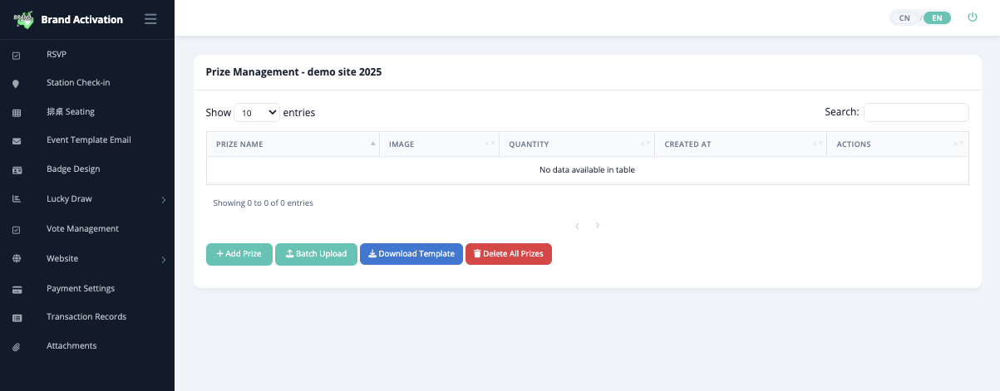

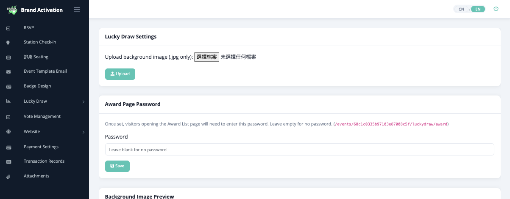

### 現場注意

- 未簽到用戶 **不會** 進入抽獎池  
- Panel 與大屏需同一 `eventId`，並確保 Socket 連線正常  
- Award 密碼在 luckydraw_setting 設定  

---

## 10. 支線：Badge Design

### 入口

側欄 **Badge Design** → `/events/:eventId/badges`（`badges`）

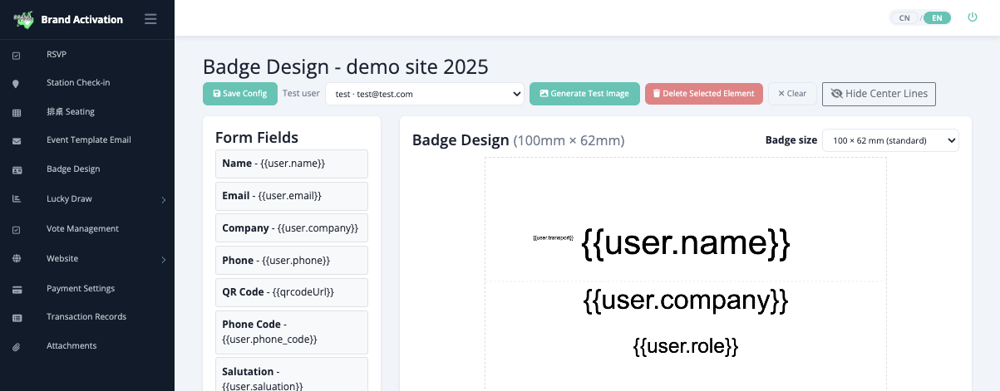

### 設定步驟

1. 選擇尺寸：**100×62 mm**（標準）或 **100×140 mm**（300 DPI）  
2. 從左欄 **Form Fields** 加入欄位（`{{user.name}}`、`{{user.company}}`、QR 等）或 **Custom Text**  
3. 在畫布調整位置、字型、對齊  
4. **Save Config** 儲存  
5. 選 **Test user** → **Generate Test Image** 預覽  

### 產出

- 後台：`GET /events/:eventId/badges/:userId/image`  
- iPad API（JWT）：`GET /api/ipad/events/:eventId/users/:userId/badge`  
- 設定 CRUD：`/api/ipad/events/:eventId/badge-config`

列印可配合 Printer Bridge（獨立 Python 服務，見 `PRINTER_BRIDGE_README.md`）。

---

## 11. 支線：排桌 Seating

### 入口

側欄 **排桌 Seating** → `/events/:eventId/seating-arrangement`（`seating`）

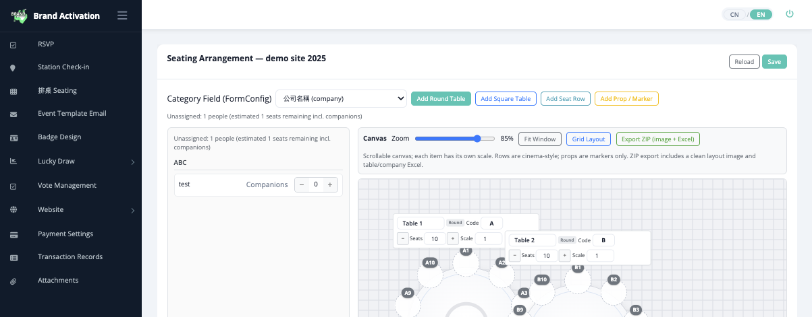

### 設定步驟

1. 選擇 **Category Field (FormConfig)**（常用 `company`）— 用來賓該欄位值分組上色  
2. 左側未排桌來賓；可設 **Companions**（佔席 = 本人 + 攜眷）  
3. 新增：**Add Round Table**／**Square Table**／**Seat Row**／**Prop / Marker**（prop 不可坐人）  
4. 每桌可設：桌名、座位代號前綴（A/B…）、座位數、縮放  
5. 拖放安排座位；支援掉位（swap）  
6. **Save**  
7. **Export ZIP (image + Excel)** 匯出平面圖 + 座位名單  

### 注意

- 刪除 RSVP 用戶後，儲存排桌會自動清掉無效 userId  
- 座位圈顏色 = 分類值（非簽到狀態）  
- 簽到狀態請以 RSVP／報告為準  

---

## 12. 驗收 Checklist

### 上線前（Tech）

- [ ] `DOMAIN` 為正式 https 網域  
- [ ] 郵件可寄（SES 或該活動 SMTP）  
- [ ] （付費）Webhook 已指向正式 DOMAIN 且付款測試通過  
- [ ] FormConfig：H1／Section／Field／成功頁／關閉頁 OK（已 Save Config）  
- [ ] Welcome／Yes-No／payment_receipt 模板內容已審  
- [ ] 自動電郵開關符合客戶要求（記住 Yes/No 會壓過 welcome）  
- [ ] Staff 帳號 `allowedEvents` + 功能鍵正確  
- [ ] 報名連結（slug 或 eventId）已交給客戶  

### 活動當日

- [ ] 報名已關閉或控流（如需要）  
- [ ] 簽到方式就緒（列表／掃描／分站）  
- [ ] （如有）Badge／Printer／排桌／抽獎 Panel + 大屏  

### 活動後

- [ ] 下載簽到報告  
- [ ] （付費）匯出交易  
- [ ] （如有）抽獎名單、排桌 ZIP 存檔  

---

## 13. 路徑速查

```
# 主線
/events/list
/events/create
/events/:eventId                          # RSVP + Auto Email Setting
/formConfig/:eventId                      # Reg Page Config（全部報名表設定）
/events/:eventId/payment-settings
/events/:eventId/emailTemplate
/events/:eventId/emailTemplate/create
/events/:eventId/email-records
/web/:eventId/register
/{registerSlug}
/web/:eventId/register/success
/web/webhook/stripe
/web/webhook/wonder
/events/:eventId/scan
/events/:eventId/station-checkin
/events/:eventId/report

# 支線
/prizes/:eventId/prizes/list
/events/:eventId/luckydraw_setting
/events/:eventId/luckydraw-config/edit
/events/:eventId/luckydraw/panel
/games/app/luckydraw_1/?id=:eventId
/events/:eventId/luckydraw/list
/events/:eventId/luckydraw/award
/events/:eventId/badges
/events/:eventId/seating-arrangement
```

---

## 附錄 A：FormConfig「去邊改」速查卡

| 需求 | 展開／捲到 |
|------|------------|
| 開關報名／關閉文案／短網址 slug | **Registration Page** |
| 報名頁 H1 活動名、副標、灰色提示 | **Register Header Event Name** |
| Banner 圖 | **Event Banner Management** |
| 條款 T&C | **Terms & Conditions** |
| 額外同意 checkbox | **Agreement** |
| 成功頁「感謝你參加」文案 | **Thank You → General / Paid** |
| Yes/No 題 + 對應電郵模板 | **Thank You → Yes / No Question** |
| 票券區按鈕文案（非價錢） | **Payment Tickets (… UI)** |
| 預設語言／語言掣 | **Language Settings** |
| 「聯絡人資料」等分區標題 | 頁面下方 **Section title** |
| 欄位 label／placeholder／必填／類型 | 頁面下方各 **Field** 卡片 |
| 加欄／加區 | **+ Add Field** / **+ Add Section** |
| 票價錢、售賣期、promo | 側欄 **Payment Settings**（唔喺 FormConfig） |
| 後台活動顯示名 | RSVP → **Edit Event Name** |

---

## 附錄 B：截圖清單

| 檔案 | 內容 |
|------|------|
| `01-events-list.png` | 活動列表 |
| `02-rsvp-guest-list.png` | RSVP 來賓列表 |
| `03-auto-email-settings.png` | 自動電郵設定彈窗 |
| `04-reg-page-config.png` | FormConfig 總覽 |
| `04b-formconfig-register-page.png` | Registration Page（開關／slug） |
| `05-formconfig-header-title.png` | Register Header（改 H1） |
| `06-formconfig-thankyou-yesno.png` | Thank You / Yes-No |
| `07-formconfig-sections-fields.png` | Section／Field 編輯 + Preview |
| `08-create-event.png` | 建立活動 |
| `09-email-templates.png` | Email 模板列表 |
| `10-email-template-create.png` | 建立 Email 模板 |
| `11-payment-settings.png` | 付費票券設定 |
| `12-public-register.png` | 前台報名表 |
| `13-station-checkin.png` | 分站簽到 |
| `14-badge-design.png` | 徽章設計 |
| `15-seating.png` | 排桌 |
| `16-prizes-list.png` | 獎品管理 |
| `17-luckydraw-setting.png` | 抽獎頁面設定 |

---

## 附錄 C：相關專門文件（可能部分過時）

| 文件 | 主題 |
|------|------|
| `ENV_CONFIGURATION.md` | 環境變數詳解 |
| `STRIPE_WEBHOOK_SETUP.md` / `WONDER_PAYMENT.md` | 付款 |
| `IPAD_API_DOCUMENTATION.md` | iPad JWT API |
| `SOCKET_IO_LUCKYDRAW.md` | 抽獎 Socket |
| `PRINTER_BRIDGE_README.md` | 列印橋 |
| `SMS_SETUP_GUIDE.md` | SMS |

若與本 SOP 衝突，**以 main 現行程式碼／本 SOP 為準**，並應更新舊文件。
