# User Guide：後台操作位置指南

> 只講 **去邊度改／撳邊個掣**。技術細節請睇 `TECH_SOP_EVENT_LIFECYCLE.md`。  
> 截圖：`docs/user-guide-screenshots/`（demo site 2025）

**適用對象**：後台操作員／活動負責人  
**入口**：登入後 → 活動列表 → 點入活動

---

## 目錄

1. [側欄地圖（先識路）](#1-側欄地圖先識路)
2. [帳號與權限（/auth/users）](#2-帳號與權限authusers)
3. [建立／管理活動](#3-建立管理活動)
4. [報名表（最常改）](#4-報名表最常改)
5. [電郵模板與自動寄信](#5-電郵模板與自動寄信)
6. [付費票券](#6-付費票券)
7. [來賓／簽到／報告](#7-來賓簽到報告)
8. [抽獎 Lucky Draw](#8-抽獎-lucky-draw)
9. [徽章 Badge](#9-徽章-badge)
10. [排桌 Seating](#10-排桌-seating)
11. [速查表：想改 X → 去邊](#11-速查表想改-x--去邊)

---

## 1. 側欄地圖（先識路）

進入任一活動後，左邊側欄就係主要入口：

| 側欄項目 | 用來做咩 |
|----------|----------|
| **RSVP** | 來賓名單、加人、簽到、自動電郵設定、匯入／報告 |
| **Station Check-in** | 分站簽到 |
| **排桌 Seating** | 座位圖 |
| **Event Template Email** | 電郵模板 |
| **Badge Design** | 名牌設計 |
| **Lucky Draw** ▾ | 抽獎相關（展開後有子選單） |
| **Website** ▾ | 報名頁預覽／**Reg Page Config（改報名表）** |
| **Payment Settings** | 票券價錢、promo |
| **Transaction Records** | 付款紀錄 |
| **Attachments** | 附件 |

### Website 子選單（改報名表喺呢度）

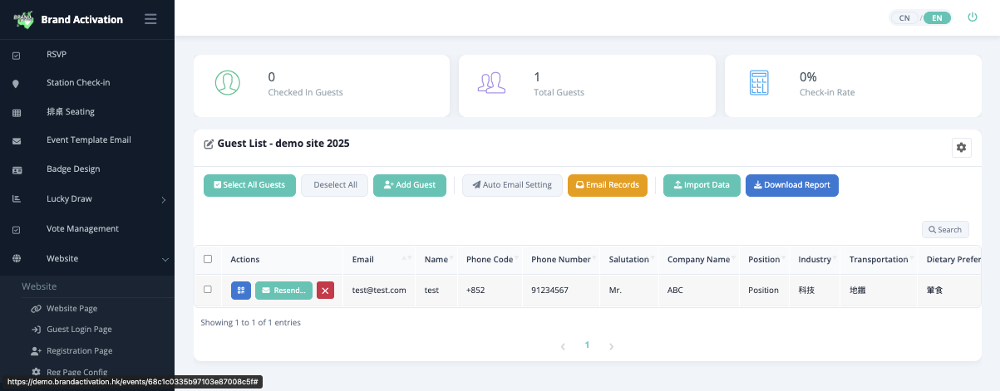

| 子項目 | 作用 |
|--------|------|
| Website Page | 活動網站頁 |
| Guest Login Page | 來賓登入頁 |
| **Registration Page** | **預覽**公開報名表（唔係改設定） |
| **Reg Page Config** | **改**報名表全部設定（標題、欄位、成功頁…） |

### Lucky Draw 子選單

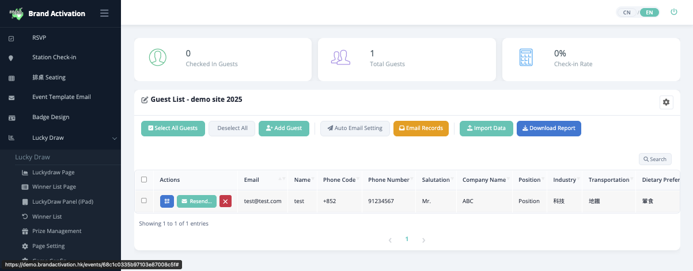

| 子項目 | 作用 |
|--------|------|
| Luckydraw Page | 開獎大屏 |
| Winner List Page | 公開中獎頁 |
| LuckyDraw Panel (iPad) | 現場控制面板 |
| Winner List | 後台中獎名單 |
| **Prize Management** | **加／改獎品** |
| **Page Setting** | **背景圖、中獎頁密碼** |
| Game Config | 遊戲畫面設定 |

---

## 2. 帳號與權限（/auth/users）

> 只有 **admin** 先睇到呢頁。用來加後台帳號，同 assign 邊啲活動／功能俾人用。

### 入口

**位置**：活動列表 `/events/list` → 右上 **Login Account Management**（用戶圖示）→ `/auth/users`  
或直接開 `/auth/users`

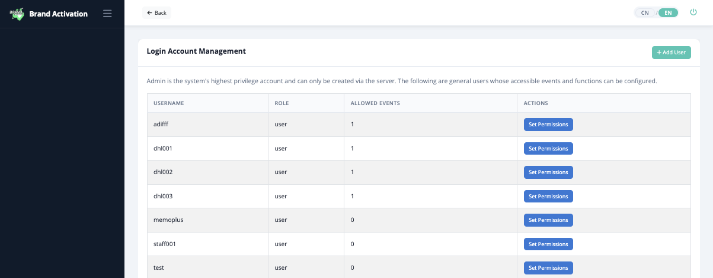

| 想做 | 撳邊 |
|------|------|
| 加新後台帳號 | **+ Add User** |
| 設定該人可進邊啲活動＋功能 | 該列 **Set Permissions** |

### 加帳號

**位置**：`/auth/users` → **+ Add User**

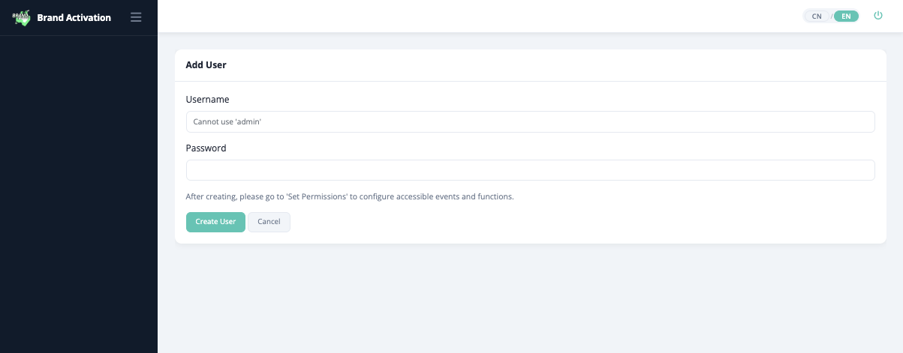

填 Username、Password → **Create User**。  
建立後要再去 **Set Permissions**，否則仲未有活動權限。

### Set Permissions（兩步）

**位置**：帳號列表 → **Set Permissions**

**① 先勾 Allowed Events**（可進入邊啲活動）

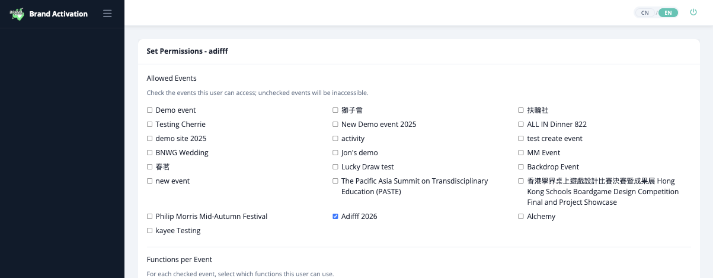

**② 再喺 Functions per Event 勾功能**（每個已勾活動一張卡）

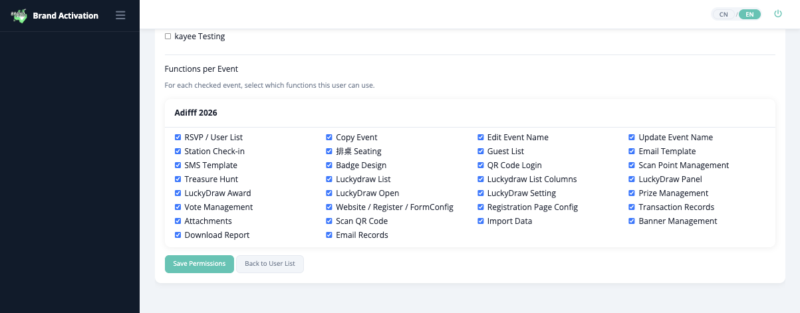

常見要開嘅功能（按需要勾）：

| 想俾人做 | 勾邊啲 |
|----------|--------|
| 睇／管來賓名單 | RSVP / User List |
| 改報名表 | Registration Page Config（+ Website / Register） |
| 電郵模板 | Email Template（+ Email Records） |
| 下載報告 | Download Report |
| 分站簽到 | Station Check-in |
| 掃 QR | Scan QR Code |
| 排桌 | 排桌 Seating |
| 徽章 | Badge Design |
| 抽獎 | Prize Management + 相關 LuckyDraw… |
| 付費／交易 | Transaction Records（建議連 RSVP 一齊開） |

改完撳 **Save Permissions** → **Back to User List**。

---

## 3. 建立／管理活動

### 活動列表

**位置**：登入後首頁／頂部品牌 → 活動列表

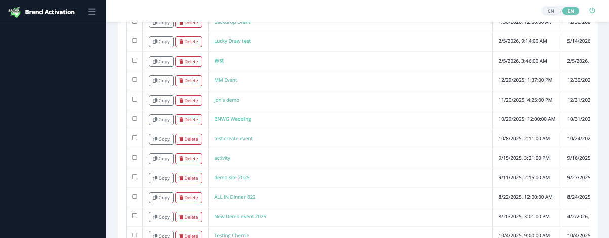

| 想做 | 撳邊 |
|------|------|
| 開新活動 | **Create Event** |
| 進入活動 | 點活動名稱 |
| 複製活動 | 該列 **Copy** |
| 刪除活動 | 該列 **Delete**（需權限） |
| 批量下載報告 | **Batch Download Report** |
| 管理後台帳號／權限 | 右上 **Login Account Management** → `/auth/users` |

### 建立活動

**位置**：列表 → Create Event

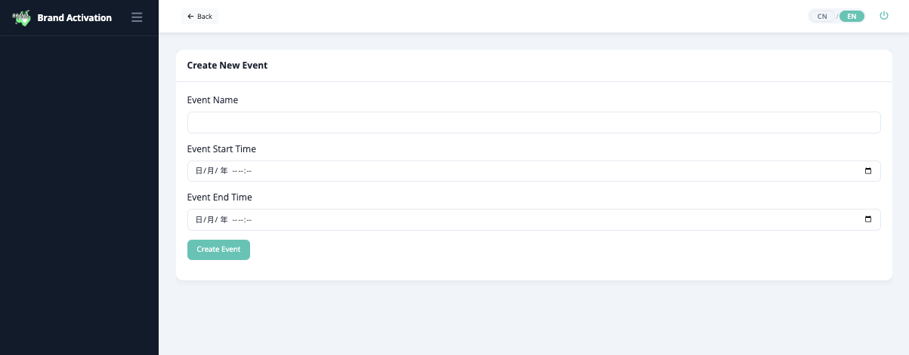

只需填：活動名稱、開始時間、結束時間 → **Create Event**。

### 改活動名稱（後台顯示名）

**位置**：RSVP 頁 → 標題旁 **Edit Event Name**

> 報名頁頂部大標題唔係呢度改，要去 **Website → Reg Page Config**（見下節）。

---

## 4. 報名表（最常改）

**入口**：側欄 **Website → Reg Page Config**

改完記得撳右上／頁頂 **Save Config**。

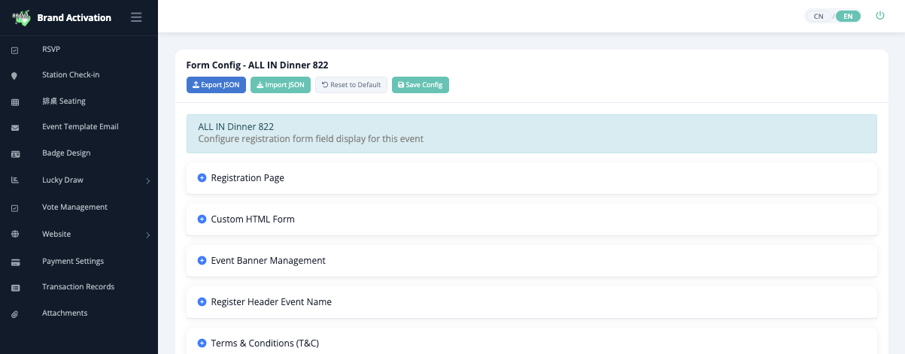

頁面係一堆**可展開卡片**；撳藍色 ＋ 展開後先見到欄位。

---

### 4.1 開關報名／關閉文案／短網址

**展開卡片**：`Registration Page`

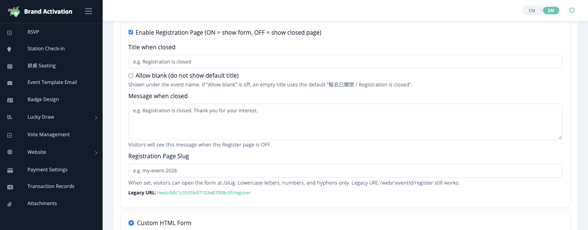

| 想改 | 改邊個欄 |
|------|----------|
| 開關報名 | **Enable Registration Page** |
| 關閉時標題／訊息 | Title when closed／Message when closed |
| 短網址 slug | **Registration Page Slug** |
| 舊版連結 | 頁面顯示嘅 Legacy URL（可複製） |

---

### 4.2 報名頁大標題、副標

**展開卡片**：`Register Header Event Name`

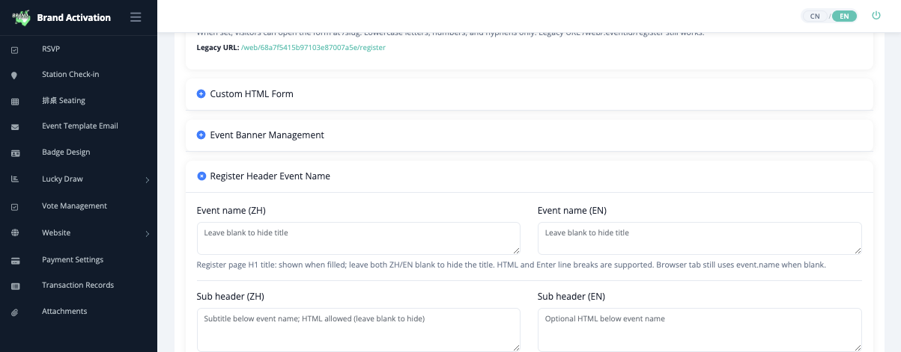

| 想改 | 改邊個欄 |
|------|----------|
| 報名頁 H1 活動名 | Event name (ZH)／(EN) |
| 副標題 | Sub header (ZH)／(EN) |
| 灰色提示字 | Subtitle / hint (ZH)／(EN) |

兩邊 Event name 留空 = 報名頁唔顯示大標題。

---

### 4.3 Banner 圖

**展開卡片**：`Event Banner Management` → 上傳／刪除圖片。

---

### 4.4 條款／同意書

| 想改 | 展開卡片 |
|------|----------|
| 條款 T&C | **Terms & Conditions (T&C)** |
| 額外同意 checkbox | **Agreement** |

---

### 4.5 成功頁文案、Yes/No 題

**展開卡片**：`Thank You (success page)`

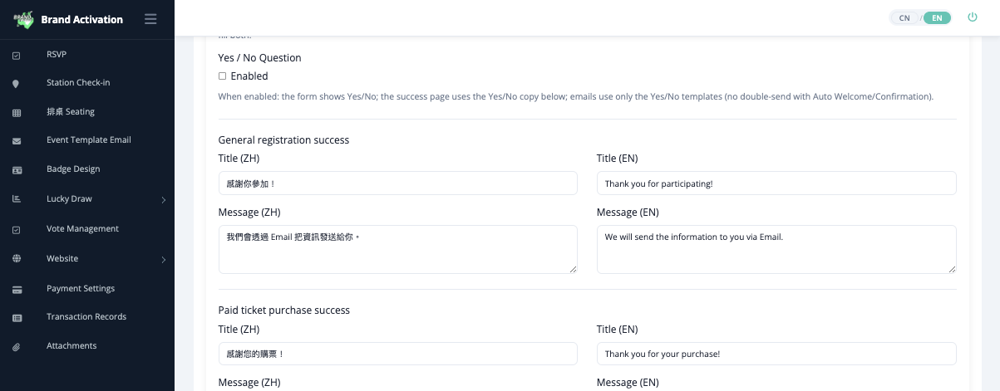

| 想改 | 改邊 |
|------|------|
| 免費報名成功字 | General registration success |
| 付費成功字 | Paid ticket purchase success |
| Yes/No 題＋對應電郵模板 | **Yes / No Question**（勾 Enabled） |

---

### 4.6 表單分區標題、欄位內容

**位置**：同一頁**向下捲**到 Section／Field 區（Form Preview 上面）

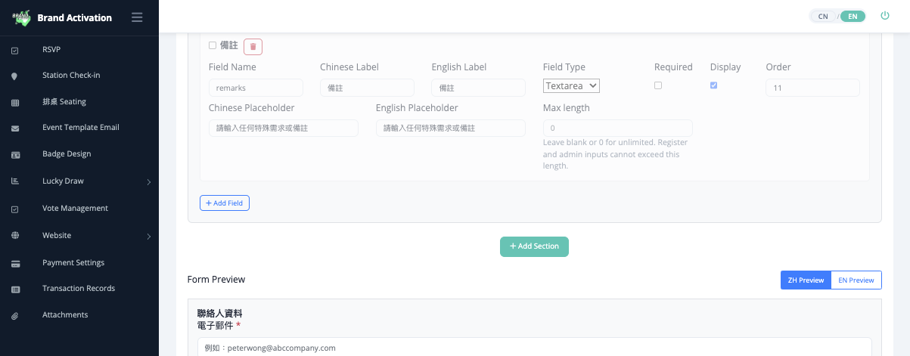

| 想改 | 改邊 |
|------|------|
| 「聯絡人資料」等分區標題 | 該區 **Section title (ZH/EN)** |
| 欄位顯示名稱 | 該欄 **Label ZH/EN** |
| 輸入提示字 | **Placeholder ZH/EN** |
| 必填／是否顯示 | **Required**／**Display** |
| 欄位類型 | **Type** 下拉 |
| 加欄位 | **+ Add Field** |
| 加分區 | **+ Add Section** |
| 睇效果 | 下方 **Form Preview** |

---

### 4.7 語言切換

**展開卡片**：`Language Settings`（預設語言、是否顯示中英掣）。

---

### 4.8 預覽公開報名頁

**位置**：側欄 **Website → Registration Page**（只睇、唔喺度改）

或直接開公開連結（Reg Page Config 內有 Legacy URL）。

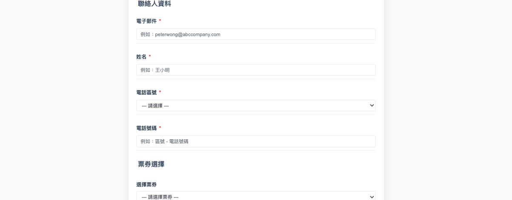

---

## 5. 電郵模板與自動寄信

### 5.1 電郵模板

**位置**：側欄 **Event Template Email**

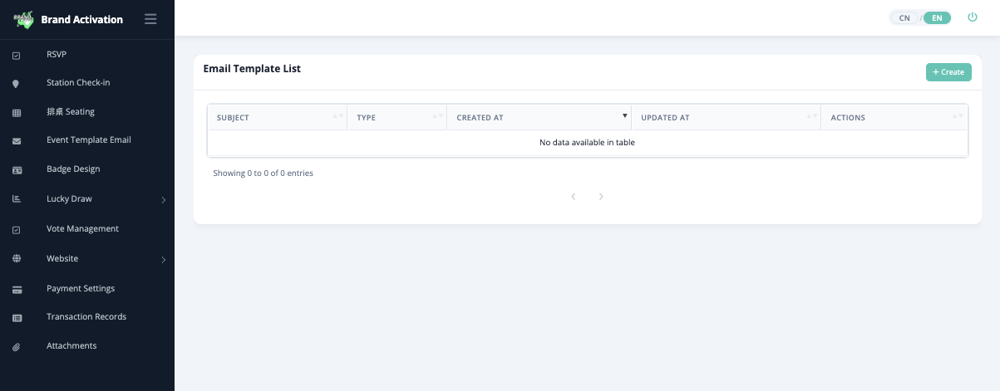

| 想做 | 撳邊 |
|------|------|
| 新建模板 | **+ Create** |
| 編輯主旨／內容／類型 | 建立／編輯頁（見下圖） |
| 載入該類型樣板 | **Load template for this type** |

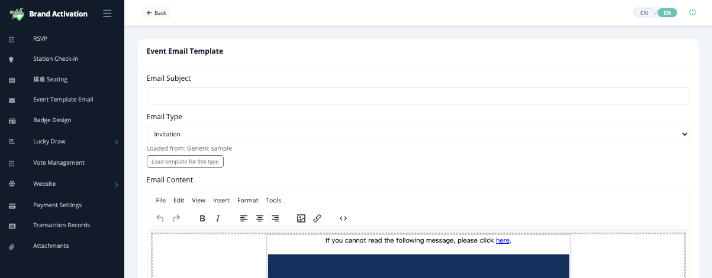

---

### 5.2 自動寄信開關

**位置**：側欄 **RSVP** → 工具列 **Auto Email Setting**

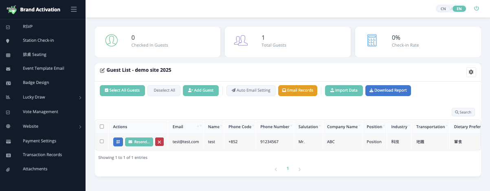

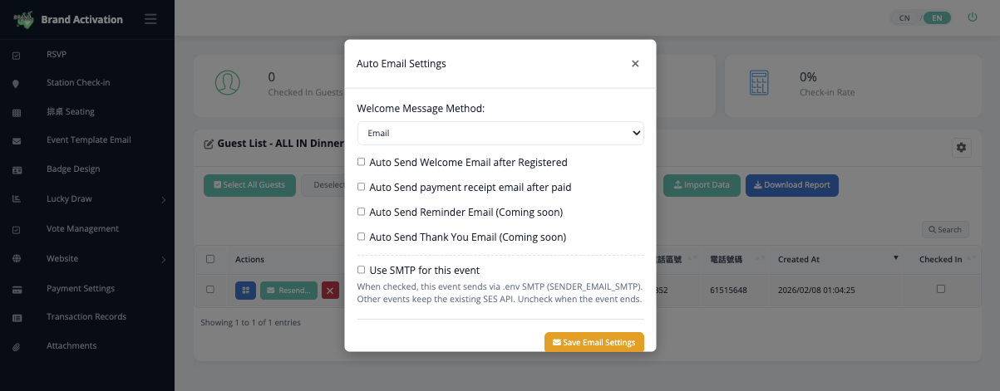

喺彈窗勾選 Welcome／付款收據等 → **Save Email Settings**。

### 5.3 手動寄信／紀錄

| 想做 | 位置 |
|------|------|
| 單人重寄 | RSVP 列表該列 **Resend...** |
| 批量寄 | 勾選來賓 → 批量寄電郵 |
| 睇寄信紀錄 | RSVP → **Email Records** |

---

## 6. 付費票券

**位置**：側欄 **Payment Settings**

> 票**價錢／售賣期／promo** 喺呢度改。  
> 報名頁票券區**按鈕文案**喺 **Website → Reg Page Config → Payment Tickets (…)****。

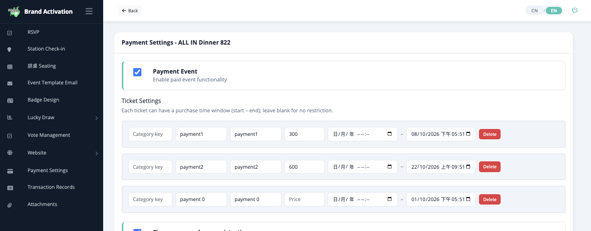

| 想改 | 改邊 |
|------|------|
| 開／關付費活動 | **Payment Event** |
| 票名／價錢／時段 | Ticket Settings 每一列 |
| 加票 | **Add Ticket** |
| 折扣碼 | Promo Codes 區 → **Add Promo Code** |
| 報名頁顯示折扣碼欄 | **Promo code display** |
| 儲存 | **Save Payment Settings** |
| 睇交易 | 側欄 **Transaction Records** |

---

## 7. 來賓／簽到／報告

### 7.1 來賓名單（RSVP）

**位置**：側欄 **RSVP**

| 想做 | 撳邊 |
|------|------|
| 手動加人 | **+ Add Guest** |
| 匯入 Excel | **Import Data** |
| 下載報告 | **Download Report** |
| 下載 QR | 該列 **Download QR Code**（格仔掣附近） |
| 刪人 | 該列紅色 **✕** |
| 手動簽到 | 該列 **Checked In** checkbox |
| 搜尋 | **Search** |
| 顯示欄位 | 齒輪／**Column Visibility** |

### 7.2 分站簽到

**位置**：側欄 **Station Check-in**

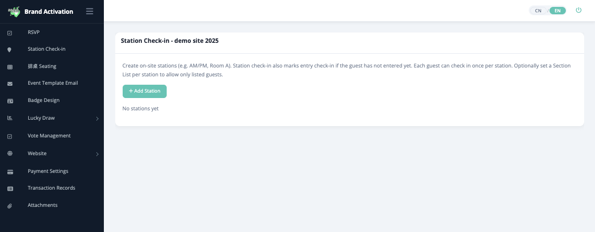

撳 **+ Add Station** 建立分站，再喺該分站做現場簽到。

---

## 8. 抽獎 Lucky Draw

**位置**：側欄 **Lucky Draw**（展開子選單）

### 獎品

**Lucky Draw → Prize Management**

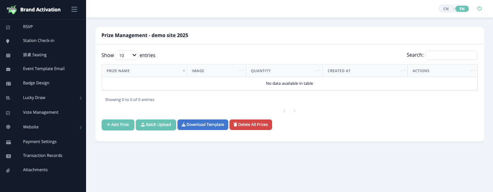

| 想做 | 撳邊 |
|------|------|
| 加獎品 | **+ Add Prize** |
| 批量上傳 | **Batch Upload** |
| 下載 Excel 範本 | **Download Template** |
| 清空 | **Delete All Prizes** |

### 背景圖／中獎頁密碼

**Lucky Draw → Page Setting**

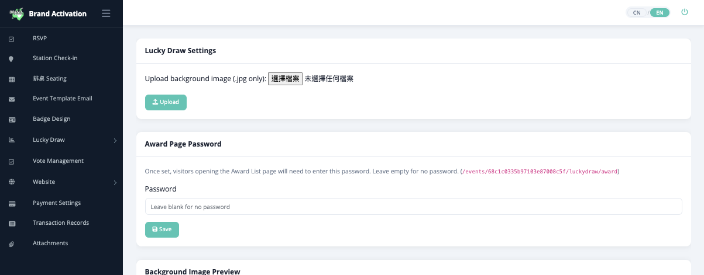

| 想改 | 改邊 |
|------|------|
| 抽獎背景圖 | 上傳 .jpg → **Upload** |
| 公開中獎頁密碼 | Password → **Save** |

### 現場抽獎

| 想做 | 去邊 |
|------|------|
| iPad 控制 | Lucky Draw → **LuckyDraw Panel (iPad)** |
| 開獎大屏 | **Luckydraw Page** |
| 後台中獎名單 | **Winner List** |
| 公開中獎頁 | **Winner List Page** |
| 遊戲畫面 | **Game Config** |

---

## 9. 徽章 Badge

**位置**：側欄 **Badge Design**

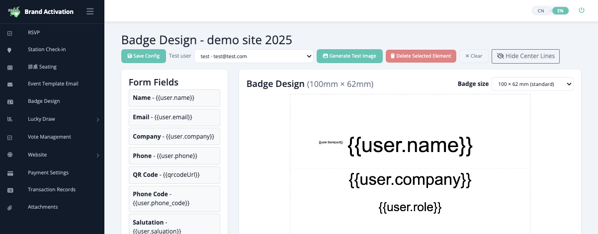

| 想做 | 撳邊 |
|------|------|
| 改尺寸 | **Badge size** 下拉 |
| 加欄位到名牌 | 左邊 Form Fields／Custom Text → 加到畫布 |
| 儲存設計 | **Save Config** |
| 預覽效果 | 選 **Test user** → **Generate Test Image** |
| 清畫布 | **Clear** |

---

## 10. 排桌 Seating

**位置**：側欄 **排桌 Seating**

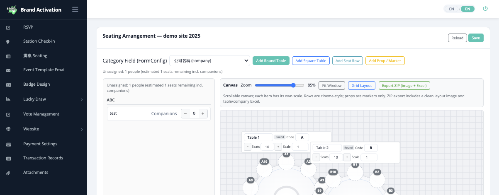

| 想做 | 撳邊 |
|------|------|
| 分類依據（如公司） | 頂部 **Category Field** 下拉 |
| 加圓桌／方桌／排座 | **Add Round／Square Table／Seat Row** |
| 加擺設（唔坐人） | **Add Prop / Marker** |
| 改座位數／代號 | 每張桌旁的數字／代號欄 |
| 安排來賓 | 左邊未排名單拖去座位 |
| 儲存 | **Save** |
| 匯出圖＋Excel | **Export ZIP (image + Excel)** |

---

## 11. 速查表：想改 X → 去邊

| 想改／想做 | 去邊 |
|------------|------|
| 加後台帳號／設權限 | 活動列表 → **Login Account Management** → `/auth/users` |
| 指定可進邊啲活動 | `/auth/users` → **Set Permissions** → Allowed Events |
| 指定活動內可做邊啲功能 | Set Permissions → Functions per Event → **Save Permissions** |
| 開新活動 | 活動列表 → **Create Event** |
| 後台活動名稱 | RSVP → **Edit Event Name** |
| **報名頁大標題／副標** | Website → **Reg Page Config** → **Register Header Event Name** |
| **報名開關／關閉文案／短網址** | Reg Page Config → **Registration Page** |
| **欄位名稱／placeholder／必填** | Reg Page Config → 向下捲 **Fields** |
| **「聯絡人資料」等分區標題** | Reg Page Config → **Section title** |
| Banner 圖 | Reg Page Config → **Event Banner Management** |
| 成功頁「感謝你…」 | Reg Page Config → **Thank You** |
| Yes/No 題與對應電郵 | Reg Page Config → **Thank You → Yes/No** |
| 預覽報名頁 | Website → **Registration Page** |
| 電郵模板內容 | **Event Template Email** → Create／編輯 |
| 自動寄 Welcome 信 | RSVP → **Auto Email Setting** |
| 重寄電郵 | RSVP 列表 → **Resend...** |
| 票價錢／promo | **Payment Settings** |
| 付款紀錄 | **Transaction Records** |
| 加人／匯入／報告 | RSVP → Add Guest／Import／Download Report |
| 主場簽到 | RSVP 列表 → Checked In |
| 分站簽到 | **Station Check-in** |
| 獎品 | Lucky Draw → **Prize Management** |
| 抽獎背景／密碼 | Lucky Draw → **Page Setting** |
| 名牌設計 | **Badge Design** |
| 排桌 | **排桌 Seating** |

---

## 附註

- 改 **Reg Page Config**／**Payment Settings**／**Badge**／**排桌** 後，記得撳該頁的 **Save**／**Save Config**。  
- 需要流程說明、寄信互斥規則、環境變數等 → 見 `TECH_SOP_EVENT_LIFECYCLE.md`。
